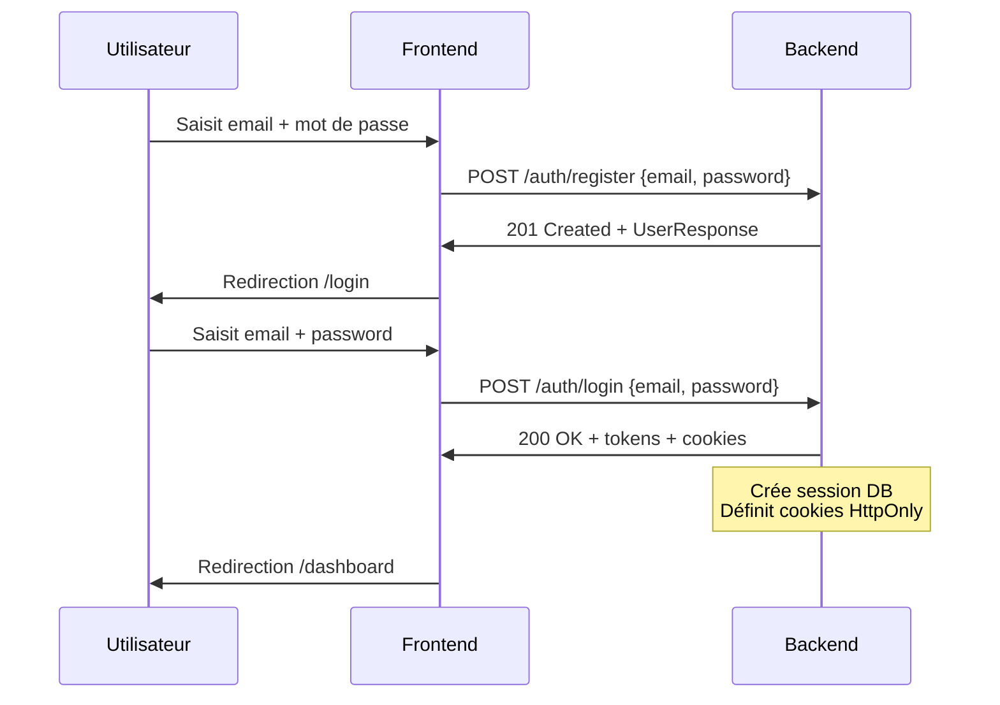
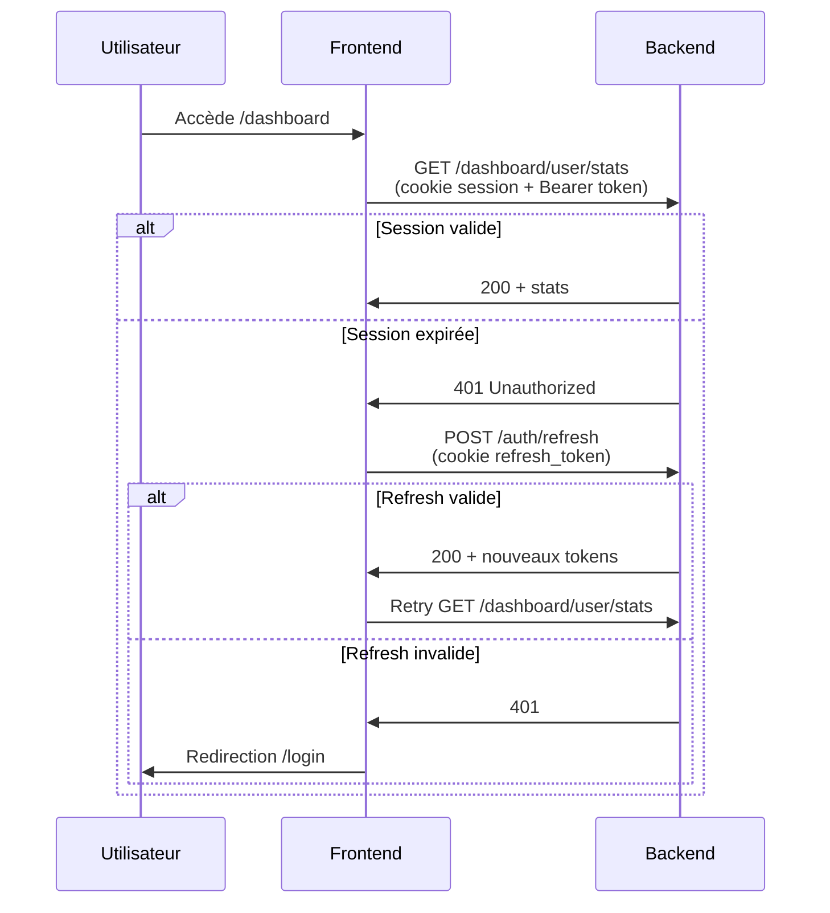
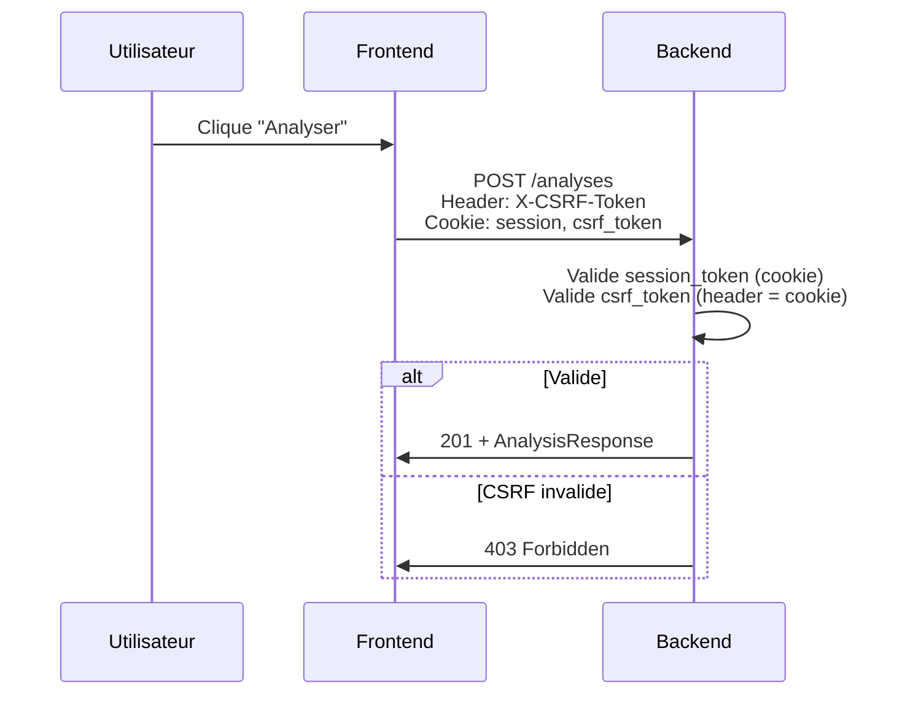

# Flux d'authentification — PhishGuard CI

**Version :** 1.0  
**Date :** 7 novembre 2026

---

## 1. Vue d'ensemble

L'authentification PhishGuard CI combine :
- **JWT** (Access + Refresh tokens) pour l'API stateless
- **Sessions DB** avec cookies HttpOnly pour la sécurité
- **CSRF tokens** double-submit pour les requêtes modifiantes
- **MFA** (placeholder) pour comptes admin

---

## 2. Schéma des tokens

### 2.1 Access Token (JWT)
- **Algorithme :** HS256
- **TTL :** 30 minutes (`PHISHGUARD_ACCESS_TOKEN_EXPIRE_MINUTES`)
- **Payload :**
  ```json
  {
    "sub": "uuid-utilisateur",
    "role": "USER|ADMIN|SUPER_ADMIN",
    "exp": 1731000000,
    "type": "access"
  }
  ```
- **Usage :** Header `Authorization: Bearer <token>` OU cookie `session`

### 2.2 Refresh Token (JWT)
- **Algorithme :** HS256
- **TTL :** 7 jours (`PHISHGUARD_REFRESH_TOKEN_EXPIRE_DAYS`)
- **Payload :**
  ```json
  {
    "sub": "uuid-utilisateur",
    "exp": 1731500000,
    "type": "refresh"
  }
  ```
- **Usage :** Cookie HttpOnly `refresh_token` OU header `Authorization`

### 2.3 Session DB
- **Table :** `sessions`
- **Champs clés :** `session_token`, `csrf_token`, `user_id`, `expires_at`, `ip_hash`, `is_mfa_verified`
- **TTL :** Aligné sur access token (30 min), renouvelé à chaque activité

---

## 3. Flux détaillés

### 3.1 Inscription → Connexion



### 3.2 Connexion avec session existante



### 3.3 Requête modifiante (CSRF)



---

## 4. Gestion des cookies

### 4.1 Cookies définis par le backend

| Cookie | Attributs | Utilisation |
|---|---|---|
| `session` | `HttpOnly; Secure; SameSite=Lax; Path=/; Max-Age=1800` | Authentification requête |
| `csrf_token` | `HttpOnly=false; Secure; SameSite=Lax; Path=/; Max-Age=1800` | Lecture JS pour header `X-CSRF-Token` |
| `refresh_token` | `HttpOnly; Secure; SameSite=Lax; Path=/; Max-Age=604800` | Renouvellement token |

### 4.2 Configuration frontend requise

```javascript
// Axios/Fetch doit avoir :
axios.defaults.withCredentials = true;  // OBLIGATOIRE pour cookies

// Pour CSRF : lire le cookie csrf_token
function getCsrfToken() {
  return document.cookie
    .split('; ')
    .find(row => row.startsWith('csrf_token='))
    ?.split('=')[1];
}

// Ajouter au header pour POST/PATCH/DELETE
axios.interceptors.request.use(config => {
  if (['post', 'patch', 'delete'].includes(config.method)) {
    const csrf = getCsrfToken();
    if (csrf) config.headers['X-CSRF-Token'] = csrf;
  }
  return config;
});
```

---

## 4. Gestion du cycle de vie des tokens

### 4.1 Expiration access token (30 min)

```typescript
// Intercepteur axios
api.interceptors.response.use(
  response => response,
  async error => {
    if (error.response?.status === 401 && !error.config._retry) {
      error.config._retry = true;
      
      try {
        // Tentative refresh silencieux
        await api.post('/auth/refresh');
        
        // Retry la requête originale
        return api.request(error.config);
      } catch {
        // Refresh échoué = déconnexion complète
        clearAuth();
        window.location.href = '/login?expired=1';
      }
    }
    return Promise.reject(error);
  }
);
```

### 4.2 Expiration refresh token (7 jours)

- L'utilisateur doit se reconnecter avec email/mot de passe
- Pas de renouvellement automatique du refresh token

---

## 5. MFA (Admin uniquement) — Implémentation complète

### 5.1 Architecture MFA

- **Algorithme :** TOTP (RFC 6238) — HMAC-SHA1, 30s step, 6 chiffres
- **Chiffrement secret :** Fernet (AES-128-GCM) — clé dédiée `PHISHGUARD_TOTP_ENCRYPTION_KEY`
- **Stockage :** Secret chiffré en base (`totp_secret` VARCHAR(255)), jamais en clair
- **Rôles concernés :** `ADMIN`, `SUPER_ADMIN` uniquement
- **Protection rate limiting :** 5 échecs → verrouillage 15 min (`mfa_locked_until`)

### 5.2 Endpoints MFA

#### 5.2.1 Initialiser MFA — `POST /auth/mfa/setup`

```http
POST /api/v1/auth/mfa/setup
Authorization: Bearer <access_token>
Content-Type: application/json

{}
```

**Permissions :** `ADMIN` ou `SUPER_ADMIN` requis

**Réponse 200 :**
```json
{
  "secret": "gAAAAABl...",           // Secret TOTP chiffré (Fernet, base64)
  "provisioning_uri": "otpauth://totp/PhishGuard%20CI:admin%40example.com?secret=JBSWY3DPEHPK3PXP&issuer=PhishGuard%20CI"
}
```

**Description :**
- Génère un nouveau secret TOTP (base32)
- Le chiffre avec Fernet avant stockage en base
- Retourne le secret **chiffré** + URI provisioning pour QR code
- MFA **non activé** (`mfa_enabled=false`) tant que `/mfa/verify` n'est pas appelé avec code valide

**Erreurs :**
| Code | Cause |
|------|-------|
| `403` | Rôle `USER` (non admin) |
| `400` | MFA déjà activé |

---

#### 5.2.2 Vérifier et activer MFA — `POST /auth/mfa/verify`

```http
POST /api/v1/auth/mfa/verify
Authorization: Bearer <access_token>
Content-Type: application/json

{
  "code": "123456"
}
```

**Permissions :** `ADMIN` ou `SUPER_ADMIN` requis

**Réponse 200 :**
```json
{
  "mfa_enabled": true,
  "message": "MFA enabled successfully"
}
```

**Logique de vérification :**
1. Vérifie que `mfa_locked_until` n'est pas dans le futur (sinon `429`)
2. Déchiffre `totp_secret` avec Fernet
3. Vérifie code TOTP (fenêtre ±1 step = ±30s)
4. Si **valide** : `mfa_enabled=true`, `failed_mfa_attempts=0`, `mfa_locked_until=null`
5. Si **invalide** : `failed_mfa_attempts++` ; si ≥5 → `mfa_locked_until=now()+15min`, retour `429`

**Erreurs :**
| Code | Cause |
|------|-------|
| `403` | Rôle `USER` |
| `400` | Setup non initié (`totp_secret` null) ou MFA déjà activé |
| `429` | Verrouillé (5 échecs, attendre 15 min) |
| `401` | Code invalide |

---

#### 5.2.3 Désactiver MFA — `POST /auth/mfa/disable`

```http
POST /api/v1/auth/mfa/disable
Authorization: Bearer <access_token>
Content-Type: application/json

{
  "code": "123456"
}
```

**Permissions :** `ADMIN` ou `SUPER_ADMIN` requis

**Réponse 200 :**
```json
{
  "mfa_enabled": false,
  "message": "MFA disabled successfully"
}
```

**Logique :**
1. Vérifie `mfa_locked_until` (sinon `429`)
2. Déchiffre `totp_secret`, vérifie code TOTP
3. Si **valide** : `mfa_enabled=false`, `totp_secret=null`, compteurs remis à 0
4. Si **invalide** : même logique verrouillage que `/mfa/verify`

**Erreurs :**
| Code | Cause |
|------|-------|
| `403` | Rôle `USER` |
| `400` | MFA non activé |
| `429` | Verrouillé |
| `401` | Code invalide |

---

### 5.3 Connexion admin avec MFA

```http
POST /api/v1/auth/login
Content-Type: application/json

{
  "email": "admin@example.com",
  "password": "password",
  "mfa_code": "123456"
}
```

**Logique :**
1. Vérifie email/mot de passe
2. Si rôle `ADMIN`/`SUPER_ADMIN` :
   - Si `mfa_enabled=false` → `403` "MFA not configured"
   - Si `mfa_code` manquant → `401` "MFA code required"
   - Si code invalide → `401` "Invalid MFA code"
3. Crée session avec `is_mfa_verified=true`

---

### 5.4 Variables d'environnement MFA

```env
# Clé de chiffrement Fernet (32 bytes url-safe base64 = 44 chars)
# Générer avec : python -c "import base64; print(base64.urlsafe_b64encode(b'x'*32).decode())"
PHISHGUARD_TOTP_ENCRYPTION_KEY=MDAwMDAwMDAwMDAwMDAwMDAwMDAwMDAwMDAwMDAwMDA=

# Clé JWT (distincte, min 32 chars)
PHISHGUARD_SECRET_KEY=cle-jwt-separee-tres-longue-et-securisee

# Optionnel : fenêtre de tolérance TOTP (défaut 1 step = ±30s)
# PHISHGUARD_TOTP_VALID_WINDOW=1
```

---

### 5.5 Sécurité MFA

| Mesure | Implémentation |
|--------|----------------|
| Chiffrement secret | Fernet (AES-128-GCM) authentifié |
| Clé séparée JWT | `PHISHGUARD_TOTP_ENCRYPTION_KEY` ≠ `PHISHGUARD_SECRET_KEY` |
| Clé hors dépôt | Variable d'env seulement, jamais en dur |
| Rate limiting | 5 essais → 15 min verrouillage persistant (DB) |
| Concurrence | Compteur atomique en DB (transaction) |
| Activation confirmée | Seulement après code TOTP valide |
| Désactivation confirmée | Seulement après code TOTP valide |
| Journalisation | Événements `MFA_SETUP`, `MFA_VERIFY`, `MFA_DISABLE` dans `activity_logs` (sans secrets) |

---

## 6. Verrouillage compte (Login)

| Échecs consécutifs | Action |
|---|---|
| 1-4 | Incrément compteur `failed_login_attempts` |
| 5 | `locked_until = now()` (verrouillage temporaire) |
| Déverrouillage | Connexion réussie → reset à 0 |

---

## 6. Révocation sessions

### 6.1 Déconnexion simple

```http
POST /auth/logout
Cookie: session=abc123

→ Supprime session DB
→ Efface cookies session, csrf_token
```

### 6.2 Révocation totale

```http
DELETE /auth/me/sessions
X-CSRF-Token: <csrf_token>
Cookie: session=abc123

→ Supprime TOUTES sessions DB de l'utilisateur
→ Efface cookies
→ Force reconnexion sur tous appareils
```

---

## 6. Sécurité

### 6.1 Checklist frontend

| Mesure | Implémentation |
|---|---|
| `withCredentials: true` | ✅ Obligatoire |
| `X-CSRF-Token` sur POST/PATCH/DELETE | ✅ Via intercepteur |
| Access token en mémoire uniquement | ✅ Variable JS, pas localStorage |
| Refresh token jamais en JS | ✅ Cookie HttpOnly seulement |
| Déconnexion auto sur 401 non récupérable | ✅ Intercepteur axios |
| Redirection `/login?expired=1` | ✅ UX claire |

### 6.2 Variables d'environnement backend

```env
PHISHGUARD_SECRET_KEY=clé-32-caractères-minimum
PHISHGUARD_ALGORITHM=HS256
PHISHGUARD_ACCESS_TOKEN_EXPIRE_MINUTES=30
PHISHGUARD_REFRESH_TOKEN_EXPIRE_DAYS=7
PHISHGUARD_CORS_ORIGINS=https://app.lovable.app,https://votre-domaine.com
PHISHGUARD_COOKIE_SECURE=true  # true en production HTTPS
```

---

## 7. Codes d'erreur auth

| Code | Endpoint | Cause | Action frontend |
|---|---|---|---|
| `401` | Tous | Token manquant/invalide/expiré | Tentative refresh → `/login` |
| `401` | `/login` | Identifiants invalides | Afficher "Email ou mot de passe incorrect" |
| `401` | `/login` (admin) | MFA manquant | Afficher champ MFA |
| `403` | `/dashboard/admin/*` | Rôle insuffisant | Rediriger `/dashboard` |
| `403` | POST/PATCH/DELETE | CSRF invalide | Recharger page (nouveau token) |
| `429` | `/analyses` | Quota dépassé | Afficher `Retry-After` secondes |

---

## 8. Variables d'environnement frontend

```env
# .env.local
VITE_API_BASE_URL=https://api.phishguard-ci.example.com/api/v1
VITE_APP_NAME=PhishGuard CI
VITE_ACCESS_TOKEN_TTL_MINUTES=30
VITE_REFRESH_TOKEN_TTL_DAYS=7
```

---

*Document généré pour l'intégration frontend — PhishGuard CI Backend v0.1.0*

---

## 9. Procédure de récupération MFA (Admin)

### 9.1 Contexte et principes

La récupération MFA est une procédure **exceptionnelle**, **contrôlée** et **auditée** pour les comptes `ADMIN` ou `SUPER_ADMIN` ayant perdu l'accès à leur application TOTP (téléphone perdu, application supprimée, etc.).

**Principes de sécurité :**
- **Aucune route API de désactivation MFA par un tiers** — pas d'endpoint `POST /admin/users/{id}/mfa/disable`
- **Nécessite une vérification d'identité forte** (hors bande)
- **Traçabilité complète** dans `activity_logs`
- **Révocation de l'ancien secret** + réenrôlement obligatoire
- **Approbation `SUPER_ADMIN` requise** pour les comptes `ADMIN`
- **Auto-récupération impossible** pour `SUPER_ADMIN` (procédure hors bande)

---

### 9.2 Scénarios de récupération

| Scénario | Acteur demandeur | Approbateur | Procédure |
|----------|------------------|-------------|-----------|
| Admin perd TOTP | Admin concerné | SUPER_ADMIN | Demande via canal sécurisé (email pro, ticket ITSM) |
| SUPER_ADMIN perd TOTP | SUPER_ADMIN concerné | Aucun (procédure hors bande) | Intervention DB directe + audit trail |

---

### 9.3 Procédure standard : Admin → SUPER_ADMIN

#### Étape 1 : Demande formelle
L'admin contacte le SUPER_ADMIN via canal vérifié (email professionnel, Slack/Teams vérifié, ticket ITSM avec numéro) :
- Identifiant du compte (email)
- Justification (perte téléphone, réinitialisation app, etc.)
- Confirmation qu'aucun accès suspect n'a été détecté

#### Étape 2 : Vérification d'identité par le SUPER_ADMIN
Le SUPER_ADMIN valide :
- [ ] Email professionnel correspondant au compte
- [ ] Canal de communication vérifié (pas de DM non vérifié)
- [ ] Aucune activité suspecte récente sur le compte (vérifier `activity_logs`)
- [ ] Demande tracée dans système de ticket (ITSM) avec référence

#### Étape 3 : Exécution récupération (par SUPER_ADMIN)

**Option A — Via interface d'administration (si développée) :**
```http
POST /api/v1/dashboard/admin/users/{user_id}/mfa/recovery
Authorization: Bearer <super_admin_token>
X-CSRF-Token: <csrf_token>
Content-Type: application/json

{
  "ticket_ref": "ITSM-2026-11-0042",
  "reason": "Perte téléphone - réinitialisation Google Authenticator"
}
```

**Option B — Via script SQL direct (actuel, pas d'endpoint API) :**
```sql
-- 1. Journaliser l'opération AVANT modification
INSERT INTO activity_logs (user_id, event_type, event_metadata, ip_hash, created_at)
VALUES (
  'uuid-admin-concerne',
  'MFA_RECOVERY_INITIATED',
  '{"initiated_by": "uuid-super-admin", "ticket_ref": "ITSM-2026-11-0042", "reason": "Perte téléphone"}',
  'hash-ip-super-admin',
  NOW()
);

-- 2. Révoquer l'ancien secret et désactiver MFA
UPDATE users
SET mfa_enabled = false,
    totp_secret = NULL,
    failed_mfa_attempts = 0,
    mfa_locked_until = NULL,
    updated_at = NOW()
WHERE id = 'uuid-admin-concerne' AND role = 'ADMIN';

-- 3. Journaliser la réussite
INSERT INTO activity_logs (user_id, event_type, event_metadata, ip_hash, created_at)
VALUES (
  'uuid-admin-concerne',
  'MFA_RECOVERY_COMPLETED',
  '{"initiated_by": "uuid-super-admin", "ticket_ref": "ITSM-2026-11-0042"}',
  'hash-ip-super-admin',
  NOW()
);
```

#### Étape 4 : Réenrôlement par l'admin
1. L'admin se connecte avec email/mot de passe (sans MFA car désactivé)
2. Appelle `POST /auth/mfa/setup` → nouveau secret + QR code
3. Scanne QR code dans nouvelle application TOTP
4. Appelle `POST /auth/mfa/verify` avec code → MFA réactivé

#### Étape 5 : Confirmation et clôture
- SUPER_ADMIN vérifie dans `activity_logs` que `MFA_VERIFY` a suivi `MFA_RECOVERY_COMPLETED`
- Clôture du ticket ITSM avec référence aux logs d'audit

---

### 9.4 Procédure d'urgence : SUPER_ADMIN

**Aucun endpoint API ni interface** — intervention directe en base par DBA autorisé :

```sql
-- 1. Journaliser (si possible via application, sinon manuel dans ticket)
-- 2. Révoquer
UPDATE users
SET mfa_enabled = false,
    totp_secret = NULL,
    failed_mfa_attempts = 0,
    mfa_locked_until = NULL
WHERE id = 'uuid-super-admin' AND role = 'SUPER_ADMIN';

-- 3. Créer entrée d'audit manuelle dans activity_logs
INSERT INTO activity_logs (user_id, event_type, event_metadata, ip_hash, created_at)
VALUES (
  'uuid-super-admin',
  'MFA_RECOVERY_SUPER_ADMIN',
  '{"reason": "Perte TOTP SUPER_ADMIN", "executed_by": "dba-authorized", "ticket_ref": "ITSM-2026-11-0099"}',
  'hash-ip-dba',
  NOW()
);
```

**Exigences post-intervention :**
- Double vérification par un second DBA ou responsable sécurité
- Ticket ITSM avec signatures numériques des deux validateurs
- Rotation de la clé `PHISHGUARD_TOTP_ENCRYPTION_KEY` recommandée si compromis suspecté
- Rapport d'incident sécurité sous 24h

---

### 9.5 Journalisation d'audit

Tous les événements MFA sont tracés dans `activity_logs` :

| Event Type | Description | Métadonnées clés |
|------------|-------------|------------------|
| `MFA_SETUP` | Initialisation MFA | `provisioning_uri` (sans secret) |
| `MFA_VERIFY` | Activation MFA réussie | `mfa_enabled: true` |
| `MFA_VERIFY_FAILED` | Échec vérification | `failed_attempts`, `locked_until` |
| `MFA_DISABLE` | Désactivation MFA volontaire | `mfa_enabled: false` |
| `MFA_DISABLE_FAILED` | Échec désactivation | `failed_attempts`, `locked_until` |
| `MFA_RECOVERY_INITIATED` | Demande récupération | `initiated_by`, `ticket_ref`, `reason` |
| `MFA_RECOVERY_COMPLETED` | Récupération effectuée | `initiated_by`, `ticket_ref` |
| `MFA_RECOVERY_SUPER_ADMIN` | Récupération SUPER_ADMIN | `executed_by`, `ticket_ref` |

**Champs sensibles JAMAIS logués :**
- `totp_secret` (chiffré ou non)
- Codes TOTP
- `provisioning_uri` complet (contient secret en clair) — tronqué ou hashé

---

### 9.6 Checklist de sécurité récupération MFA

| Contrôle | Implémentation |
|----------|----------------|
| Aucune route API tierce | Pas d'endpoint `/admin/users/{id}/mfa/disable` |
| Vérification identité | Canal pro vérifié + ticket ITSM |
| Approbation SUPER_ADMIN | Requise pour récupération ADMIN |
| Révocation ancien secret | `totp_secret = NULL` obligatoire |
| Réenrôlement forcé | Nouveau `MFA_SETUP` → `MFA_VERIFY` |
| Audit trail complet | `activity_logs` avec `event_type` MFA_* |
| Pas de secrets en logs | `totp_secret`, codes TOTP exclus |
| Rotation clé si compromis | Procédure documentée (voir §9.4) |
| Double validation SUPER_ADMIN | Deux validateurs pour urgence |